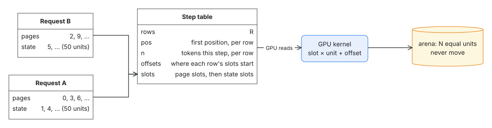
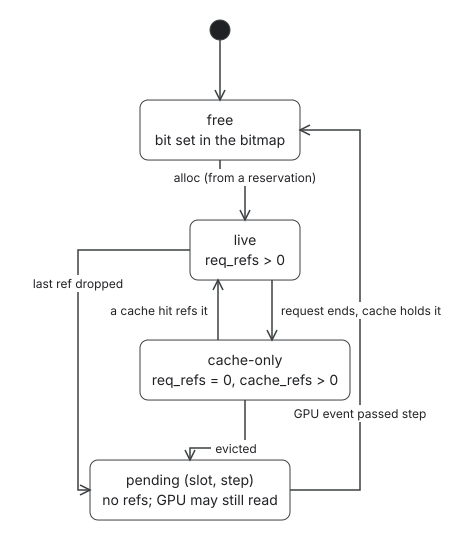
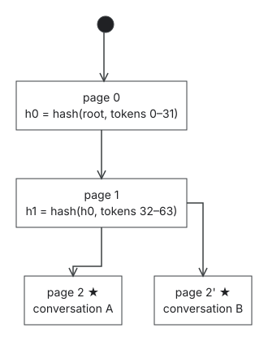

# mmmllm
## One RAM, three processors, and the bookkeeping that lets them share it

my mac mini llm: an LLM serving engine in C++/Metal on an M4 Pro Mac mini (64 GB)

How to read this: every `---` is one slide. The text under **Notes** is for studying, not for the screen.

---

## The model, as far as this talk cares


- `dense(x)`: a bunch of matmuls with fixed weights. Pure. No memory.
- `attn(x, memory)`: the only part that remembers earlier tokens. **That memory is the talk.**
- **Prefill**: run the prompt through, many tokens at once. Lots of math.
- **Decode**: one new token per request per step. Little math, lots of reading.

**Notes.** The model is a stack of layers (24 in the 0.8B model, 64 in the 27B). Treat each layer as two
functions. `dense` holds weights only: same input, same output, no state. Everything that makes the model "remember"
what came before lives in `attn`, which reads and appends to a per-request memory. Generation is a loop:
the prompt goes in once (prefill), then the model emits one token at a time, feeding each back in (decode). Prefill
does thousands of tokens per call, so it is limited by compute. Decode does one token per request per call, but must
still read every weight and the whole memory, so it is limited by memory bandwidth. Hold on to that difference: it
decides which processor does what.

---

## Two kinds of per-request memory

| | KV (full attention) | State (linear attention) |
|---|---|---|
| Grows with tokens? | yes, a fixed number of bytes per token | **no**, fixed size |
| Updated how? | append only: old tokens never change | **overwritten in place** every token |
| Can you cut it at token *t*? | yes: keep the first *t* entries | **no**: only if you saved a copy at *t* |
| 0.8B model | 12 KiB / token (6 layers) | 18.6 MiB / request (18 layers) |
| 27B model | 64 KiB / token (16 layers) | 147 MiB / request (48 layers) |

The Qwen3.5/3.6 models mix both: 1 full-attention layer in every 4.

**Notes.** "KV cache" is the full-attention memory: each token leaves a key and a value vector per layer, and later
tokens read all of them. It is append-only, so a prefix of it is just its first *t* entries. That is what makes
sharing prefixes between requests possible. Linear attention (Gated DeltaNet here) instead keeps a running summary,
one fixed-size matrix per layer, rewritten by every token. It is cheap at long context, but you cannot rewind it. The
hybrid model is where the interesting bookkeeping comes from: to reuse a cached prefix you need both the KV up to
token *t* and a snapshot of the state taken exactly at *t*.

---

# Part 1: the hardware

---

## One RAM, three processors


Decode needs bandwidth → GPU. Prefill needs math → GPU or ANE. Bookkeeping needs branches → CPU.
(ANE ~13 TFLOPS only with the weights split into small pieces; 4.1 unsplit.)

**Notes.** All three processors share one physical memory, so moving data between them costs nothing, but they
compete for the same 273 GB/s. Measured on this machine: the GPU reads big buffers at 210–238 GB/s and does bf16
matmuls at about 7.5 TFLOPS. The Neural Engine reaches 12.8–13.8 TFLOPS on prefill-shaped matmuls, but only when the
weights are cut into small pieces, and it streams weights at only ~39 GB/s. So it is useful for prefill (compute-bound)
and useless for decode (bandwidth-bound). The CPU does no math worth mentioning. It owns every counter in this talk.

---

## Decode is a bandwidth problem

```
time per decode step  ≈  bytes read  /  bandwidth
                          weights + every request's KV
```

| | weights read per step | step time (B = 1) |
|---|---|---|
| 0.8B, 4-bit | ~0.4 GB | 3.2 ms → ~310 tok/s |
| 27B, 4-bit | 14.4 GB | 64.4 ms → ~15.5 tok/s |

- Batching B requests reads the weights **once** for B tokens.
- KV is read per request, so long contexts eat the budget.

**Notes.** Each decode step reads every weight once, whatever the batch size. That is why serving many requests
together is nearly free up to a point, and why the memory layout of KV matters: at long context the KV reads catch up
with the weight reads. Prefill is the opposite: thousands of tokens per weight read, so it is limited by compute,
which is why the Neural Engine can help there.

---

## Unified memory: zero-copy, not zero-rules

- One `MTLBuffer` = the same physical pages in the CPU's **and** the GPU's page tables (16 KiB pages).
- Visibility follows command buffers: the GPU sees CPU writes made **before** commit; the CPU sees GPU writes
  **after** completion.
- The ANE writes into an IOSurface that the GPU reads as a buffer: bit-exact, no copy (measured).
- `HazardTrackingModeUntracked`: Metal doesn't order our accesses. **We do.**
- A residency set is **not a pin**: under memory pressure macOS evicted idle buffers anyway (measured).

**Notes.** "Shared memory" removes the copies but not the coordination. Between commit and completion the GPU may be
reading any byte of a buffer, and the CPU must not overwrite it. Metal can track that for you, per buffer, but our
arena is one huge buffer that every request lives in, so tracking it as one object would serialize everything. We
turn tracking off and keep the rules ourselves. Part 4 is about how.

---

# Part 2: the layout

---

## Allocate once, never in the loop

| Region | What | Lifetime |
|---|---|---|
| Weights | model files, `mmap`ed, wrapped as GPU buffers without a copy | process |
| **Arena** | every request's KV pages and state | process; contents churn |
| Workspace | activations for one step (fixed shapes) | reused every step |
| Step tables | small `uint32` arrays: which units each request owns | 2 copies, alternated |

**Notes.** Creating a GPU buffer costs syscalls, zero-filling and GPU page-table updates. So everything is sized
from the model's config at startup, the arena is pre-touched with `memset` (no page faults later), and `Memory`
asserts if anything allocates after startup. The arena size is the one memory knob (`--arena-gib`).

---

## The arena: N equal units

```
slot   0      1      2      3      4      5      6     …    N−1
     ├──────┼──────┼──────┼──────┼──────┼──────┼──────┼─ … ─┼──────┤
       KV     state  free   KV     state  state  KV           free
       req A  req A         req B  req A  req B  req A
```

- One buffer, **one unit size**. Slot `s` starts at byte `s × unit`.
- Every object is a whole number of units, **anywhere**: no adjacency, nothing to compact.
- Any free unit serves any need: KV page, state slot, snapshot copy.

**Notes.** This is the core decision. Engines often keep separate pools per kind of state, and then tune their ratio.
Here, one unit size is chosen so that one full-attention page is exactly one unit, and the linear state is just "50
units" (0.8B). A request's units can be scattered, because the GPU finds each one through a table (two slides on). No
fragmentation by construction: there is only one size.

---

## A unit, in bytes (real models)

One unit = one **page** of 32 tokens × every full-attention layer's K and V.

```
0.8B:  6 layers × 2 (K,V) × 2 heads × 32 tokens × 256 dims × 2 B = 384 KiB
27B:  16 layers × 2 (K,V) × 4 heads × 32 tokens × 256 dims × 2 B =   2 MiB

offset(g, kv, head, token) = ((g × 2 + kv) × heads + head) × 32 × 256 × 2
                             + token × 256 × 2
```

- Each (layer, K/V, head) is one **contiguous 16 KiB run**: the attention kernel streams it.
- State slot = 18.6 MiB → **50 units** (0.8B), 147 MiB → **74 units** (27B).

**Notes.** `g` is the layer's index among the full-attention layers. A unit is rounded up to a multiple of the 16 KiB
OS page. Why 32 tokens per page? Bandwidth didn't decide it: a benchmark reading shuffled units got 243–249 GB/s for
16 to 128 tokens per page, the same as one contiguous stream. 32 was picked for the other costs: at most 31 tokens
recomputed on a cache hit, and half a page wasted per request on average.

---

## The lookup table: slot numbers, not pointers



- Units never move → no virtual ids, no translation layer, no defragmentation.
- Same table for prefill and decode, same for GPU and (via the GPU) ANE output.

**Notes.** This is a page table in the OS sense, with the twist that the "MMU" is our attention kernel: it reads
the row's slot list and computes byte addresses itself. Because the unit is the only granularity, a request's memory
is just a list of `uint32`. Copying those lists into the step table each step is cheap (a few KB) and keeps the GPU
side stateless.

---

# Part 3: the metadata

---

## Per-unit counters (CPU only, one thread, no locks)

| Field | Per | Meaning |
|---|---|---|
| `free` | bitmap | reusable right now |
| `req_refs` | `uint16` per unit | live requests using it |
| `cache_refs` | `uint16` per unit | prefix-cache entries holding it |
| `pending` | (slot, step) queue | no refs left, but a GPU step may still read it |
| `free_units` | count | no refs: free **or** pending |
| `cache_only_units` | count | held by the cache and nobody else: evictable |
| `reserved` | count | promised to admitted requests, not yet taken |

**Notes.** Two reference counts, because the two owners behave differently: a request's refs go away when it ends,
the cache's refs go away when it evicts. A unit with only cache refs is "cache-only": idle, but recoverable by
eviction. One engine thread owns all of this; the processors only ever see slot numbers, never the counters, so
there are no locks anywhere.

---

## A unit's life



**Notes.** `free_units` counts free and pending units, because both have no owner: admission can count on them.
Only `alloc` cares about the difference, and it calls `retire` first. A cache-only unit is the one state that can go
back to live without passing through free: that's a cache hit. Every arrow here is one function in `Arena`:
`alloc`, `release`, `ref`, `cache_release` (on evict) and `retire`.

---

## One capacity question

```
fits(n)     = n ≤ free_units − reserved
can_ever(n) = n ≤ free_units + cache_only_units − reserved

admit(n):
    if not can_ever(n): WAIT                  # don't evict for nothing
    while not fits(n):  evict cache's oldest leaf
    reserved += n
```

- Invariant `reserved ≤ free_units` ⇒ an admitted request's `alloc()` **cannot fail**.
- `n` = pages for the uncached prompt + generation allowance + one state slot + one per snapshot it will make.

**Notes.** Every path that needs memory goes through `admit`: new requests and snapshot copies, later SSD loads and
generation top-ups. Reserving up front means no request can run out of memory mid-generation and have to be killed
or preempted. The cost is being conservative. `can_ever` stops the engine from evicting useful cache entries when
even a full eviction wouldn't make room. A bug other engines shipped (vLLM `0ff1bf9bb`): an allocation outside the
reservation quietly steals another request's units. Here it asserts.

---

## Sharing: the prefix cache



- A trie of **full pages**, keyed by chained hashes; tokens verified on lookup (a collision must never return
  wrong KV).
- Entries end on a page boundary ⇒ shared pages are **full** ⇒ never written again ⇒ **no copy-on-write**.
- A node holds `cache_refs` on its unit; a request reusing it adds `req_refs` on top.

**Notes.** Same-prefix prompts are everywhere: system prompts, multi-turn chat, agents re-sending history. Chained
hashing makes "page *i* of this prompt" a single lookup that depends on everything before it. The full-page rule is
what keeps sharing trivial: a request appends its new tokens into its *own* fresh pages, never into a shared one. The
price is recomputing up to 31 tokens on a hit.

---

## The hybrid twist: KV can resume anywhere, state only at a snapshot

```
prompt:   [ shared system prompt ......... ][ user A's question ]
pages:      p0   p1   p2   p3   p4   p5 ★    p6   p7
                                      ▲
                     KV match L = 6, deepest snapshot S = 6 → resume at token 192
```

- `match()` returns **L** (pages matched) and **S ≤ L** (deepest page with a snapshot).
- Snapshots are taken at two places per request:
  1. the **branch point**, where its match ended: the next request with this prefix resumes there;
  2. the prompt's **last full page**: the next turn of this conversation resumes there.
- A snapshot is a **copy** (requests overwrite their state in place): 50 units, ~19 MB `memcpy` on the 0.8B.

**Notes.** Without the state copy, matched KV is useless to a hybrid model: you'd have the keys and values of the
prefix but not the linear layers' summary of it. So the cache stores snapshots sparingly, only where the next hit is
likely to land. Pages between S and L are recomputed into the request's own pages. The first wave of requests sharing
a new prefix all miss (no snapshot yet); the first to finish its branch-point chunk inserts it, and every later
request resumes there.

---

## One request, through the counters

```
admit    match → ref(pages[0,S)), ref(snapshot) → admit(n) → alloc state → memcpy(snapshot → state)
prefill  chunk by chunk: alloc pages as needed (from the reservation), write KV + state
         at a snapshot point: chunk done, next not started → alloc copy → memcpy → insert (cache_ref)
decode   one token per step, alloc a page every 32 tokens
finish   unreserve the rest → release(pages + state)
           pages the cache holds → cache-only (evictable)
           the rest              → pending (until the GPU passes the step)
evict    oldest leaf: cache_release → if no request holds it → pending
```

**Notes.** This is `Engine::admit`, `snapshot` and `finish` in `src/engine.mm`, plus `Arena` in `src/memory.mm`.
The order in `admit` matters: the matched pages are referenced *before* calling `admit(n)`, because `admit` may evict,
and it must not evict the very entry this request is about to use. The snapshot point splits a prefill chunk: the copy
needs the chunk that reaches it finished and the next one not started, otherwise the state would already be past it.

---

# Part 4: the metadata under async

---

## The CPU runs ahead of the GPU

```
CPU:  build N   build N+1   build N+2 ─ wait ─   build N+3
GPU:            run N       run N+1              run N+2
                     ▲ event = N        ▲ event = N+1
```

- One decode step = one command buffer: one token for every active request.
- The GPU signals a shared event with the step number when each step finishes.
- Greedy tokens of step N feed step N+1 **on the GPU**: no CPU round trip.
- Rule: the CPU is **at most one step ahead**.

**Notes.** If the CPU waited for each step before building the next, the GPU would idle between steps (at 0.8B a step
is ~3 ms, so even 0.1 ms of gap is a few percent). So the CPU encodes step N+1 while N runs. That gives the bookkeeping
its hard question: when the CPU decides a unit is no longer needed, the GPU may still be reading it in a step that was
already committed.

---

## Free now, reuse later

```
release(slot):  refs → 0  ⇒  pending.push(slot, committed)    # counts as free for admit
retire(signaled): pending slots with step ≤ signaled → free bitmap
alloc():          retire first; nothing free? wait for the event (≤ 1 step), retire, retry
```

- **Admission** sees the unit immediately (`free_units`), so the scheduler never stalls on it.
- **Reuse** waits until the GPU has provably passed every step that could read it.
- The pending queue is ordered by step, so `retire` only looks at the front.

**Notes.** This is the trick of the whole design: separating "this memory is accounted for" from "this memory may be
overwritten". Accounting is a CPU fact and updates instantly; reuse is a GPU fact and arrives with the event. At most
one step's worth of units is ever stuck in pending, so the cost is bounded. The same rule would cover CPU writers (SSD
loads) later, which is why it's applied to every caller even though GPU writes are already ordered by the queue.

---

## Two step tables, one step ahead

```
step N   → copies[N % 2]      GPU reading
step N+1 → copies[(N+1) % 2]  CPU writing
step N+2 → copies[N % 2]      only after event ≥ N   (asserted: signaled + 2 ≥ step)
```

- The lookup table is metadata the **GPU** reads, so it needs the same care as the data.
- Two copies by parity are enough because of the one-step-ahead rule.

**Notes.** The step table is tiny but it's the most dangerous buffer: if the CPU rewrote it while the GPU was mid-step,
attention would read another request's KV. The parity scheme is the simplest thing that's safe given the one-step
rule, and the assert turns any violation into a crash instead of silent corruption. Going further ahead would need K+1
copies; that's deferred until sampling moves to the GPU.

---

## And prefill, on its own thread

- The prefill lane has its own queue: GPU, or ANE with **2 chunks in flight**; short chunks go to the GPU.
- Its K/V lands in the same arena units, through the same step-table format.
- Pending reclaim follows **decode** steps only ⇒ a request can't be released while a prefill chunk still reads it
  (asserted; cancel waits for the chunk).
- A long prefill is cut into chains of 8-layer command buffers so decode steps run in between
  (27B: decode gaps 4979 → 814 ms).

**Notes.** Two producers write into one arena. They never conflict, because a unit belongs to exactly one request
until it's shared, and shared pages are full and read-only. The remaining danger is lifetime: who's still reading a
unit. Decode steps carry the event; prefill chunks are tracked per request (`in_flight`), and finish refuses to
release a request with a chunk out.

---

## Does it pay?

| Measured (0.8B unless noted) | Without | With |
|---|---|---|
| Same 2k prompt again: time to first token | 435 ms | **19 ms** (17 tokens recomputed) |
| 8 clients, 2k prompts, 1.5k shared: TTFT median | 2.30 s | **0.75 s** |
| … total throughput | 206 tok/s | **462 tok/s** |
| Prefill vs mlx-lm (512 tokens) | 1.00× | **1.06×** |
| Decode vs mlx-lm (B = 1) | 1.00× | **1.01×** |

Cache off, batch 1: bit-exact with mlx-lm. Try it: `uvx --from 'mmmllm[compare]' mmmllm compare`.

**Notes.** Prefix-cache rows: `reports/mlx-lm baseline.md` §Prefix cache (g8), cache off vs on, back to back. When
nothing hits, the cache costs nothing measurable (TTFT and per-client decode equal the cache-off rounds). The mlx-lm
rows are from `tools/repro.sh` (now `mmmllm compare`) on this machine, 2026-11-24, 3 trials each. The speed gains are mostly in the kernels; what the memory design
buys is that serving many requests, sharing prefixes and long contexts all reuse one arena with one set of rules.

---

## Takeaways

1. **One unit size** for everything removes a whole class of tuning and fragmentation.
2. **Slot numbers + a per-step table** instead of pointers: memory never moves, the GPU stays stateless.
3. **Two refcounts** (requests, cache) make sharing and eviction simple to state.
4. **Reserve, then allocate**: an admitted request can't run out of memory.
5. **Accounting is instant, reuse waits for the GPU**: the pending queue makes async safe.
6. Hybrid models need **state snapshots**: KV is a log you can cut anywhere, a state is a value you must copy.

---

## Where to look

| Topic | File |
|---|---|
| Design, with the measurements behind each choice | `docs/memory-design.md` |
| Who calls whom | `docs/architecture.md` |
| Arena, counters, step tables | `src/memory.h`, `src/memory.mm` |
| Prefix cache | `src/prefix_cache.h`, `src/prefix_cache.mm` |
| Admit, snapshot, finish | `src/engine.mm` |
| The same design in 840 lines of Python (no prefix cache, no async) | `py/mllm/` |
