<!--
Diagram rules (docs/talk/draw.py has the same list next to the colours; keep the two in sync):
- colour = who: CPU green, GPU blue, ANE purple. A hue never means two things.
- position = when: prefill lane above decode lane.
- tag or column = which op: dense neutral grey (GPU or ANE), attn amber.
- outline = whether: solid = touches it, dashed grey = never / empty / free / done / not built yet.
- word = how: read, write, read + write. Never a colour.
- Reserved: amber = per-request memory; red hatch = pending; yellow = changed since the last frame;
  grey = shared or neutral; magenta / teal / brown = requests A / B / C.
- Layout: a grid. Columns = what is touched (layers, memory regions, units); rows = who or when.
-->

# mmmllm
## One RAM, three processors, and the bookkeeping that lets them share it

my mac mini llm: an LLM serving engine in C++/Metal on an M4 Pro Mac mini (64 GB), running Qwen3.6-27B

How to read this: every `---` is one slide. The text under **Notes** is for studying, not for the screen.
Questions like "why 32 tokens?" are answered in the FAQ at the end.

---

# Part 1: the machine

---

## One block of DRAM, three processors

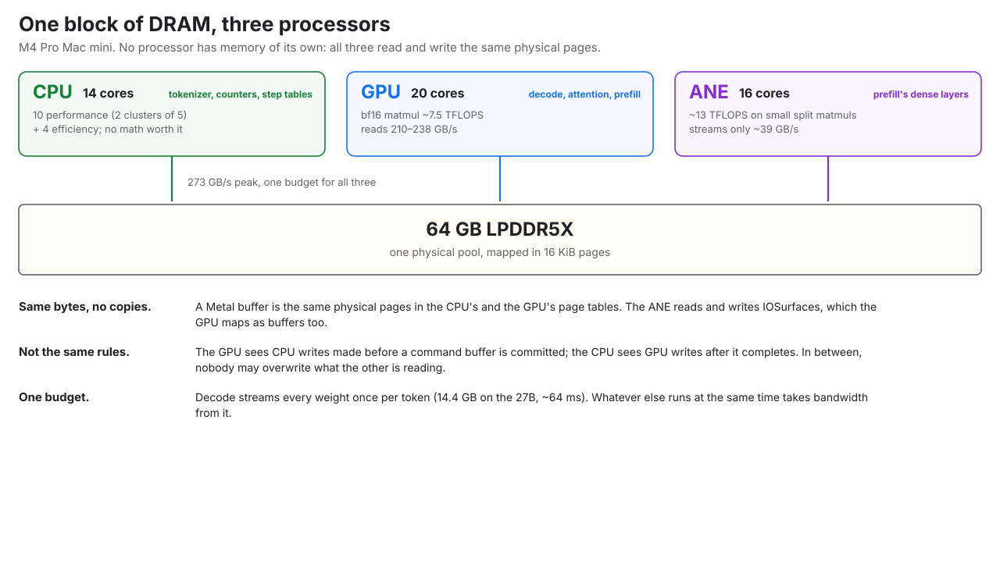

**Notes.** The Mac mini has no "GPU memory" and no "CPU memory": one 64 GB pool of LPDDR5X at 273 GB/s peak, and
three processors that all read and write it. The CPU has 14 cores (two clusters of 5 performance cores, 4 efficiency
cores). The GPU has 20 cores; measured here, it reads big buffers at 210–238 GB/s and does bf16 matmuls at about 7.5
TFLOPS. The Neural Engine (ANE) has 16 cores; it reaches 12.8–13.8 TFLOPS on prefill-shaped matmuls, but only when the
weights are cut into small pieces, and it streams weights at only ~39 GB/s. A Metal buffer is the same physical pages
in the CPU's and the GPU's page tables (16 KiB pages), and the ANE reads and writes IOSurfaces, which the GPU maps as
buffers too. So moving data between them costs nothing. What they share instead is the bandwidth: decode reads every
weight once per token, and anything else running at the same time slows it down. And they share the rules: between
commit and completion the GPU may be reading any byte of a buffer, and nobody may overwrite it. Metal can track that
per buffer, but we turn tracking off and keep the rules ourselves. The rest of the talk is those rules.

---

## How we split it

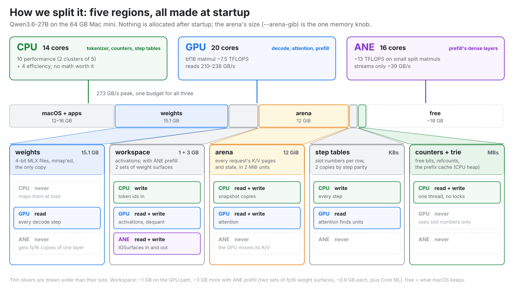

| Region | What | Size (27B) | Lifetime |
|---|---|---|---|
| Weights | model files, `mmap`ed, wrapped as GPU buffers without a copy | 15.1 GB | process |
| Workspace | activations for one step; with ANE prefill, its fp16 weight surfaces | ~1 GB, + ~3 GB | reused every step |
| **Arena** | every request's K/V pages and state | `--arena-gib`, 12 here | process; contents churn |
| Step tables | small `uint32` arrays: which units each request owns | KBs, 2 copies | rewritten every step |
| Counters, cache trie | free bits, refcounts, the prefix cache | MBs, CPU heap | process |

**Notes.** Everything is sized from the model's config at startup and never allocated again: creating a GPU buffer
costs syscalls, zero-filling and GPU page-table updates, and the arena is pre-touched with `memset` so the token loop
never page-faults. Read the columns top to bottom. Two regions are wanted by more than one processor, and they are the
two stories of this talk. The **weights**: the GPU reads them every decode step, and the ANE needs them for prefill.
The **arena**: the CPU decides what goes where, the GPU reads and writes the bytes. The step tables are how the CPU
tells the GPU where things are; they are tiny, but they are a region the GPU reads while the CPU writes the next one,
so they get the same care. They come back in Part 3. The arena size is the one memory knob (`serve` defaults to 2 GiB;
the 27B runs in this talk use 12).

---

## Who does what, and why

| Work | Limited by | Runs on | Because |
|---|---|---|---|
| Decode: one token per request per step | bandwidth: every weight, every step | GPU | 14.4 GB per step / ~220 GB/s ≈ 64 ms (27B, B = 1) |
| Prefill `dense`: hundreds of tokens per weight | compute | ANE (or GPU) | ~13 TFLOPS when split small; frees the GPU for decode |
| Attention, prefill and decode | per-request memory | GPU | the only one that reads the arena |
| Bookkeeping: counters, tables, tokenizer | branches | CPU | one thread, no locks |

**Notes.** Decode at B = 1 on the 27B reads 14.4 GB of weights to make one token: 64.4 ms per step, ~15.5 tok/s.
Batching B requests reads the weights once for B tokens, so serving many requests together is nearly free up to a
point. Prefill is the opposite: a 1,024-token chunk reuses each weight 1,024 times, so it is limited by math. That is
where the ANE helps, and it helps most by leaving the GPU to decode: GPU prefill alongside decode cuts decode from 15 to
3.3 tok/s, ANE prefill only to 12.1. The ANE at ~39 GB/s would make a decode step take 370 ms, so it never decodes.

---

# Part 2: the weights, one copy for two readers

---

## One copy of the weights, two readers

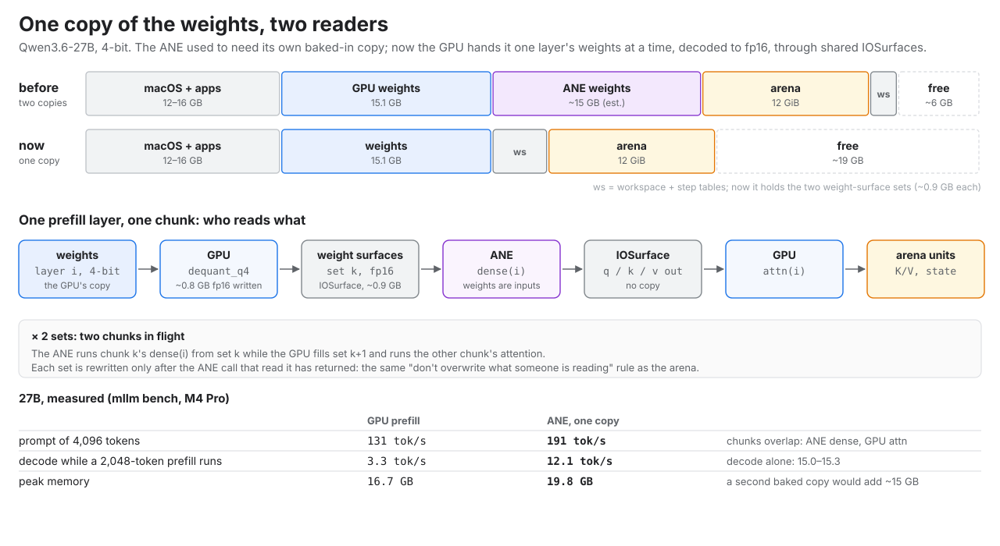

**Notes.** Core ML normally bakes the weights into the compiled model, and the ANE keeps its own copy of them: for the
27B that would be a second ~15 GB next to the GPU's, straight out of the arena's budget. Instead, every weight matrix
and norm scale is an *input* of the Core ML model. Before the ANE runs layer *i* of a chunk, the GPU dequantizes layer
*i*'s 4-bit weights from its own copy into fp16 IOSurfaces, and the ANE reads them from there. Activations cross the
same way, so neither handoff copies on the CPU. One compiled model per block kind and chunk size (4 kinds × 512 / 1024
tokens) serves all 64 layers, because the weights are no longer part of it.

"Zero-copy" is about the handoff, not the bytes: the GPU writes ~0.8 GB of fp16 per layer per chunk (~5.4 ms), and
the ANE reads weights as inputs at 20–44 GB/s, slower than baked ones. Two chunks are in flight, so there are two sets
of weight surfaces (~0.9 GB each): the ANE runs one chunk's `dense` from one set while the GPU fills the other. A set is
rewritten only after the ANE call that read it has returned, the same "don't overwrite what someone is reading" rule as
the arena. The fp16 values are the GPU's own weights, so there is no second quantization to get wrong either.

---

## What one copy costs, and what it buys

| Matmul, weights as … (M4 Pro, IOSurface I/O) | baked in | an input |
|---|---|---|
| 512 × 1024 × 4096 | 11.25 TFLOPS | 7.47 |
| 2048 × 1024 × 4096 | 14.44 | 11.65 |
| 512 × 5120 × 5120 (unsplit) | 5.38 | 3.53 |

| 27B, `mllm bench` | GPU prefill | ANE, one copy |
|---|---|---|
| prompt 1,024 tokens | 136 tok/s | 157 tok/s |
| prompt 4,096 tokens | 131 tok/s | **191 tok/s** |
| decode while a 2,048-token prefill runs | 3.3 tok/s | **12.1 tok/s** |
| peak memory | 16.7 GB | 19.8 GB |

**Notes.** Weights as inputs are slower per matmul, and splitting still matters (each linear is sliced inside the
graph into Cin ≤ 1024 × Cout ≤ 4096 pieces). A whole 27B dense block (o_proj + FFN of layer *i−1*, projections of
layer *i*, ~730 MiB of fp16 weights) takes 82.5 ms per 1,024 tokens. The CPU cost per call stays 0.08–0.15 ms whatever
the weights' size, because nothing is copied. One chunk alone gains little (ANE and GPU take turns per layer); with
chunks overlapping, prefill is 1.46× the GPU's. The bigger win is the last-but-one row: decode keeps most of its speed
while a long prompt is being read. The 3 GB of peak memory are the two weight-surface sets plus Core ML's own buffers.

---

# Part 3: the arena

---

## What goes in it

| | K/V (full attention) | State (linear attention) |
|---|---|---|
| Grows with tokens? | yes, 64 KiB per token (16 layers) | **no**, 147 MiB per request (48 layers) |
| Updated how? | append only: old tokens never change | **overwritten in place** every token |
| Can you cut it at token *t*? | yes: keep the first *t* entries | **no**: only if you saved a copy at *t* |

Qwen3.6-27B mixes both: 1 full-attention layer in every 4.

**Notes.** Attention is the only part of the model that touches per-request memory; `dense` has fixed weights and no
memory (FAQ: the model as two loops). "KV cache" is the full-attention memory: each token leaves a key and a value
vector per layer, and later tokens read all of them. It is append-only, so a prefix of it is just its first *t*
entries, which is what makes sharing prefixes between requests possible. Linear attention (Gated DeltaNet) instead
keeps a running summary, one fixed-size matrix per layer, rewritten by every token. Cheap at long context, but you
cannot rewind it. The arena holds both kinds, for every request.

---

## Cut it into blocks

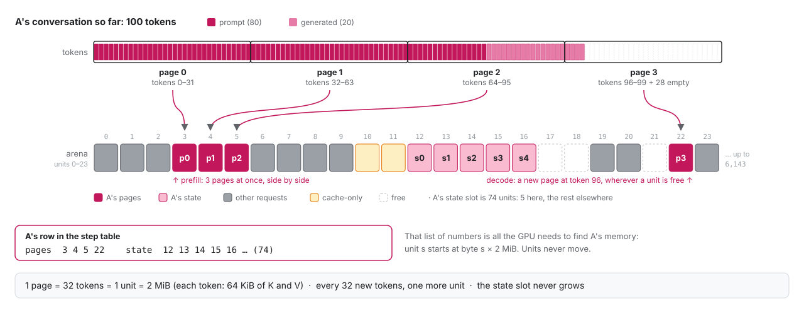

- **32 tokens = 1 page = 1 unit = 2 MiB.** A request gets one more unit every 32 tokens.
- Its state is **74 units** (147 MiB), the same for its whole life.
- 12 GiB = **6,144 units**. Any free unit serves any need: nothing to compact.

**Notes.** One unit size for everything. It is chosen so that one full-attention page is exactly one unit (16 layers ×
K and V × 4 KV heads × 32 tokens × 256 × 2 bytes = 2 MiB), and everything else, a state slot or a snapshot copy, is a
whole number of units. So there is no fragmentation by construction, and the units of one object need not be next to
each other. Prefill allocates its pages together, so they tend to be neighbours; decode adds one page every 32
tokens, wherever a unit is free. Reading scattered units costs no bandwidth (measured 243–249 GB/s, the same as one
contiguous stream). What is inside a unit: Part 4. Why 32: FAQ.

---

## A very thin bitmap

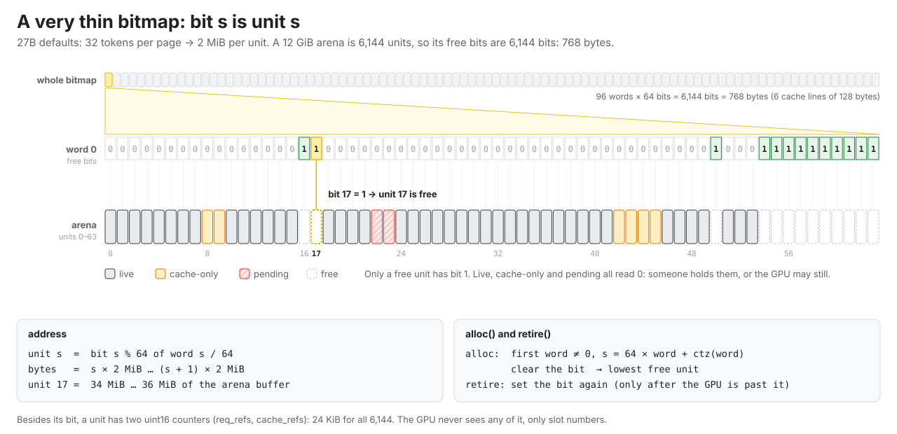

- Bit *s* **is** unit *s*: no table between them. Unit *s* starts at byte *s* × 2 MiB of the arena buffer.
- `alloc`: first non-zero word, count trailing zeros, clear that bit: the lowest free unit.
- 6,144 units → 768 bytes of bits. The GPU never sees them.

**Notes.** Units never move, so a slot number is an address, and the free list can be one bit per slot. A bit is 1
only when nobody holds the unit *and* the GPU is past every step that could read it; a unit the cache holds, or one
waiting for the GPU, reads 0 like a live one. The difference between those is in the counters on the next slide. The
whole bitmap fits in 6 cache lines (128 bytes each), and `alloc` is a loop over at most 96 words plus one `ctz` instruction. Lowest
first also means a freed unit is the first to be reused, which the frames later show.

---

## Who holds a block

| Field | Per | Meaning |
|---|---|---|
| `free` | bit per unit | reusable right now |
| `req_refs` | `uint16` per unit | live requests using it |
| `cache_refs` | `uint16` per unit | prefix-cache entries holding it |
| `pending` | (slot, step) queue | no refs left, but a GPU step may still read it |
| `free_units` | count | no refs: free **or** pending |
| `cache_only_units` | count | held by the cache and nobody else: evictable |
| `reserved` | count | promised to admitted requests, not yet taken |

**Notes.** Two reference counts, because the two owners behave differently: a request's refs go away when it ends,
the cache's refs go away when it evicts. A unit with only cache refs is "cache-only": idle, but recoverable by
eviction. One engine thread owns all of this, so there are no locks anywhere. The GPU only ever sees slot numbers,
through the step table.

---

## The step table: how the GPU finds a block

```
words: [R rows][state units per row][start_position × R][token_count × R][R + 1 offsets][page slots …][state slots …]
GPU:   address = slot × unit_bytes + offset_in_unit(layer, K/V, head, token)
```

- Each step the CPU copies every running request's slot list into it: a few KB.
- It is a page table in the OS sense, except the "MMU" is our attention kernel.
- **Two copies, by step parity**: the CPU writes step N+1's while the GPU reads step N's.

**Notes.** This is why the arena can be one big untracked buffer: the GPU is stateless about it. Every attention
kernel reads its row of the table, then computes byte addresses itself. Prefill and decode use the same format; the
prefill lane has its own copy. The table is tiny, but it is the most dangerous buffer: if the CPU rewrote it while the
GPU was mid-step, attention would read another request's K/V. Hence the two copies, and an assert that the CPU is never
more than one step ahead (`signaled + 2 ≥ step`).

---

## One capacity question

```
fits(n)     = n ≤ free_units − reserved
can_ever(n) = n ≤ free_units + cache_only_units − reserved

admit(n):
    if not can_ever(n): WAIT                  # don't evict for nothing
    while not fits(n):  evict cache's oldest leaf
    reserved += n
```

- Invariant `reserved ≤ free_units` ⇒ an admitted request's `alloc()` **cannot fail**.
- `n` = pages for the uncached prompt + generation allowance + one state slot + one per snapshot it will make.

**Notes.** Every path that needs memory goes through `admit`: new requests and snapshot copies today, SSD loads later.
Reserving up front means no request can run out of memory mid-generation and have to be killed or preempted. The cost
is being conservative. `can_ever` stops the engine from evicting useful cache entries when even a full eviction
wouldn't make room. A bug other engines shipped (vLLM `0ff1bf9bb`): an allocation outside the reservation quietly
steals another request's units. Here it asserts.

---

## Sharing: the prefix cache


- A trie of pages, keyed by chained hashes; tokens verified on lookup.
- A node holds `cache_refs` on its unit; a request reusing it adds `req_refs` on top.
- **Full** pages are shared as they are: never written again ⇒ **no copy-on-write**.
- A finished request's sequence may end mid-page: a **tail node**. A request that extends it **copies** that one unit.

**Notes.** Same-prefix prompts are everywhere: system prompts, multi-turn chat, agents re-sending history. Chained
hashing makes "page *i* of this prompt" a single lookup that depends on everything before it; a hash collision must
never return wrong K/V, so the tokens are compared too. Sharing stays trivial because no shared unit is ever written:
a full page is shared as it is, and a request continuing from a tail node gets its own copy of that 2 MiB unit and
writes the rest of the page there. A prompt that only shares full pages with the cache (a system prompt) recomputes
up to 31 tokens; a chat's next turn, which extends the whole previous sequence, recomputes nothing but the new
message (27B: turn 3's first token 3.50 s → 0.49 s, v0.3.0).

---

## KV can resume anywhere, state only at a snapshot

```
prompt:   [ shared system prompt ......... ][ user A's question ]
pages:      p0   p1   p2   p3   p4   p5 ★    p6   p7
                                      ▲
                     KV match L = 6, deepest snapshot S = 6 → resume at token 192
```

- `match()` returns **L** (pages matched) and **S ≤ L** (deepest page with a snapshot).
- Snapshots are taken at three points per request: the **branch point** where its match ended, the prompt's
  **last full page**, and the **end**: the whole sequence, prompt + reply (a chat's next turn resumes there).
- During prefill a snapshot is a **copy** (74 units, 147 MiB `memcpy` on the 27B): the request keeps changing its
  state. At the end it is **handed over**: the request is done with its state units, so they become the snapshot.

**Notes.** Without the state, matched K/V is useless to a hybrid model: you'd have the keys and values of the prefix
but not the linear layers' summary of it. So the cache stores snapshots sparingly, only where the next hit is likely
to land. Pages between S and L are recomputed into the request's own pages. A request resuming from a snapshot always
copies it into its own state slot, because it will overwrite it.

---

## One block, prefill's and the cache's at once

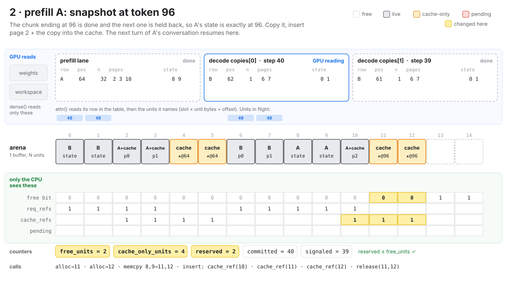

- A's prefill writes unit 10 (A's page 2): `req_refs` = 1.
- At the snapshot point the cache inserts the page **as it is**: `cache_refs` = 1 on the same unit. No copy.
- From here, A only reads it. The state is the exception: the cache gets a **copy**.

**Notes.** This is `Engine::save_snapshot`: when a prefill chunk reaches a snapshot point and the next chunk has not
started, it copies A's state into fresh units and calls `cache->insert(prompt, pages, snapshot)`, which adds a cache
ref to every page up to that point. The pages can be shared without a copy because they are full and append-only:
nobody will write them again. The state can't, because A overwrites it with every token. The pages after this point
(the partial last page, the decode pages) stay A's alone until A finishes; then its whole sequence goes in (frame 5).
The copy comes out of A's reservation (counted at admit), then the cache takes its refs and A drops its own, so the
snapshot's units are cache-only from the start.

---

## The CPU runs one step ahead

```
CPU:  build N   build N+1   build N+2 ─ wait ─   build N+3
GPU:            run N       run N+1              run N+2
                     ▲ event = N        ▲ event = N+1
```

- One decode step = one command buffer: one token for every running request.
- The GPU signals a shared event with the step number when each step finishes.
- Sampled tokens of step N feed step N+1 **on the GPU**: no CPU round trip.

**Notes.** If the CPU waited for each step before building the next, the GPU would idle between steps. So the CPU
encodes step N+1 while N runs. That gives the bookkeeping its hard question: when the CPU decides a unit is no longer
needed, the GPU may still be reading it in a step that was already committed.

---

## Free now, reuse later

```
release(slot):  refs → 0  ⇒  pending.push(slot, committed)    # counts as free for admit
retire(signaled): pending slots with step ≤ signaled → set their free bit
alloc():          retire first; nothing free? wait for the event (≤ 1 step), retire, retry
```

- **Admission** sees the unit at once (`free_units`), so the scheduler never stalls on it.
- **Reuse** waits until the GPU has provably passed every step that could read it.

**Notes.** This is the trick of the whole design: "this memory is accounted for" and "this memory may be overwritten"
are two different facts. Accounting is a CPU fact and updates instantly; reuse is a GPU fact and arrives with the
event. At most one step's worth of units is ever stuck in pending. The pending queue is ordered by step, so `retire`
only looks at the front.

---

## The life of one block

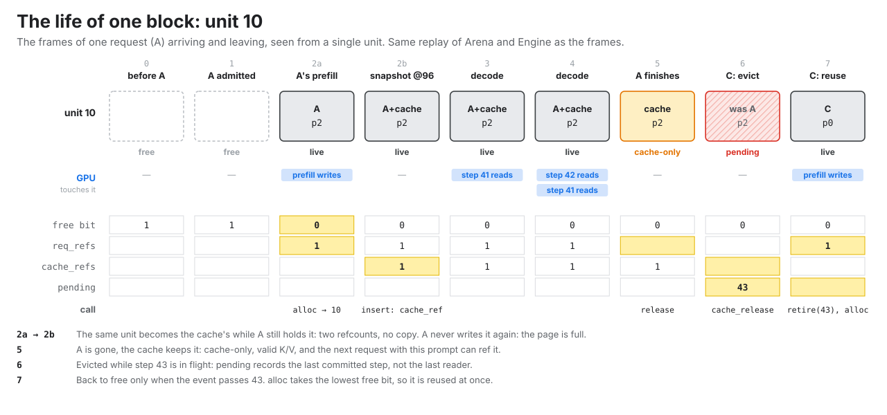

```
         alloc            insert              A finishes           evict               retire (event ≥ step)
free ──────────▶ live ──────────▶ live + cached ──────────▶ cache-only ──────────▶ pending ─────────────────────▶ free
                                                              │ ▲
                                                    cache hit └─┘ ref (live again)
```

**Notes.** One unit, followed through the frames that come next. It is free until A's prefill takes it for its page 2.
At A's snapshot the cache takes a ref on it while A still holds it. When A finishes, the cache keeps it: cache-only,
still valid K/V, and the next request with this prompt can take a ref on it and make it live again without touching
the bytes. When C needs room, the cache evicts it; no one holds it, but step 43 was already committed, so it waits in
pending. When the event passes 43, its bit goes back to 1, and since `alloc` takes the lowest free bit, C's first page
lands right there. Every arrow is one function in `Arena`: `alloc`, `ref`, `release`, `cache_release`, `retire`.

---

## The whole arena, frame by frame: where we start

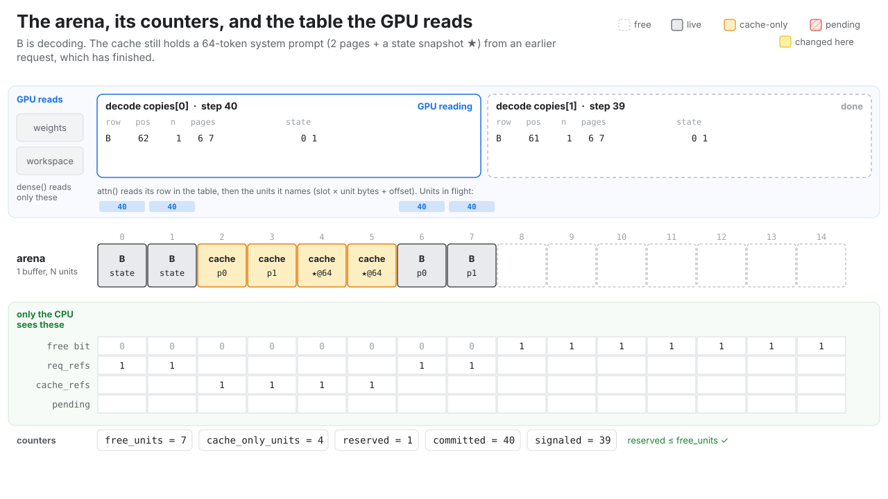

**Notes.** These frames come from `docs/talk/draw.py`, which replays `Arena` and `Engine::admit` / `snapshot` /
`finish` (v0.3.0) on a 15-unit arena, so every number is what the real code would hold (the state slot is drawn as 2 units, 74
on the 27B). Three bands, the same in every frame: on top what the GPU reads (the step tables, and which units a step
in flight touches), in the middle the arena, at the bottom the counters only the CPU sees. Highlighted cells changed
since the previous frame. The cache entry was left by an earlier request with the same system prompt.

---

## 1 · Admit: a cache hit

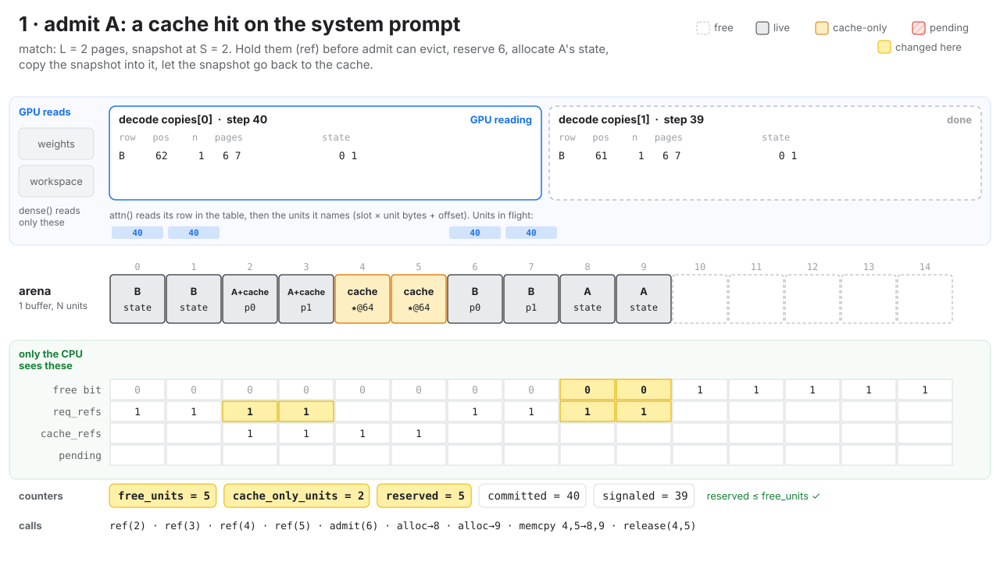

**Notes.** The system prompt's two pages and the snapshot taken after them are matched. A holds them with `ref`
*before* `admit`, because `admit` may evict and must not evict these. Then it reserves 6 units (2 more pages, its
state, one snapshot copy), allocates its state and copies the snapshot into it. The snapshot is only needed for that
copy, so A lets it go: back to cache-only. The pages stay shared: `req_refs` 1 and `cache_refs` 1.

---

## 2 · Prefill, chunk 64–95

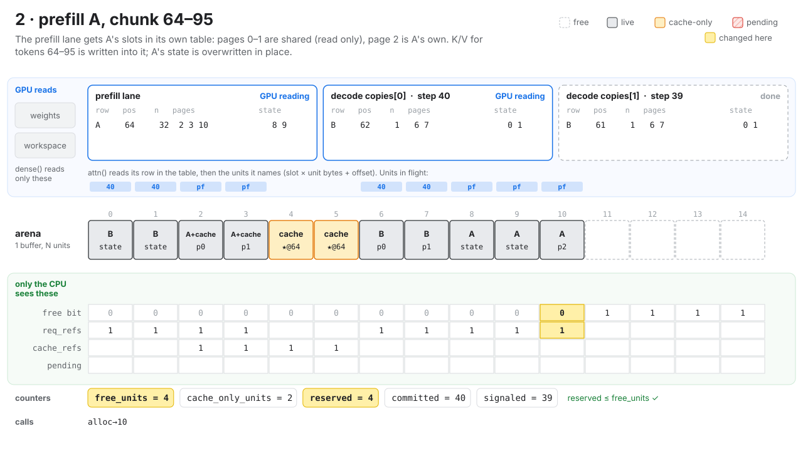

**Notes.** The prefill lane has its own table, same format. The chunk reads shared pages 2–3 and writes only A's own
page 10 and A's state. Nothing here needs a lock: the shared pages are full, so no one writes them again.

---

## 2 · Prefill, the snapshot


**Notes.** 96 is the prompt's last full page, where the next turn of this conversation will resume. The copy needs
A's state to be exactly at 96, so the lane holds the next chunk back until this one completes. Page 10 is now shared.

---

## 3 · Decode: one step ahead

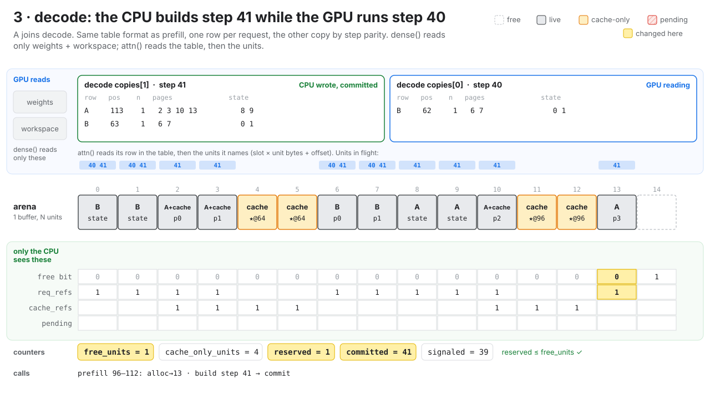

**Notes.** A's last prompt token is fed by decode, so the remaining chunk stops at 112. The CPU writes step 41 into the
other copy while the GPU still runs step 40, then commits it: two steps in flight, the most the rule allows. The strip
above the arena is what matters for reuse: units 0, 1, 6, 7 are read by both steps.

---

## 4 · Decode: a new page

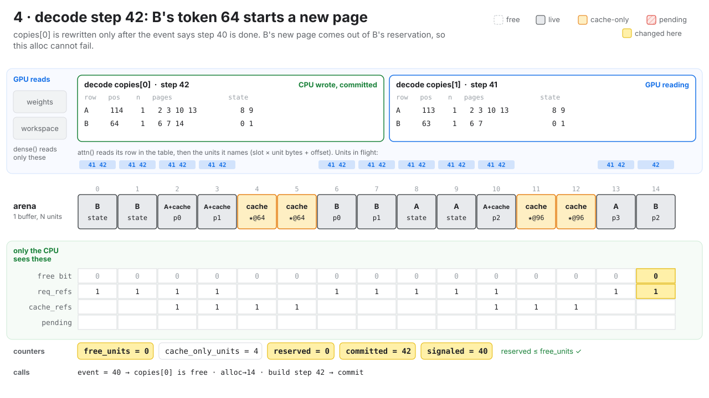

**Notes.** Before copies[0] can be rewritten for step 42, step 40 must be done: the assert `signaled + 2 ≥ step`. B's
65th token needs a third page; it comes from B's reservation, which `admit` made sure exists.

---

## 5 · Finish: the whole conversation goes into the cache

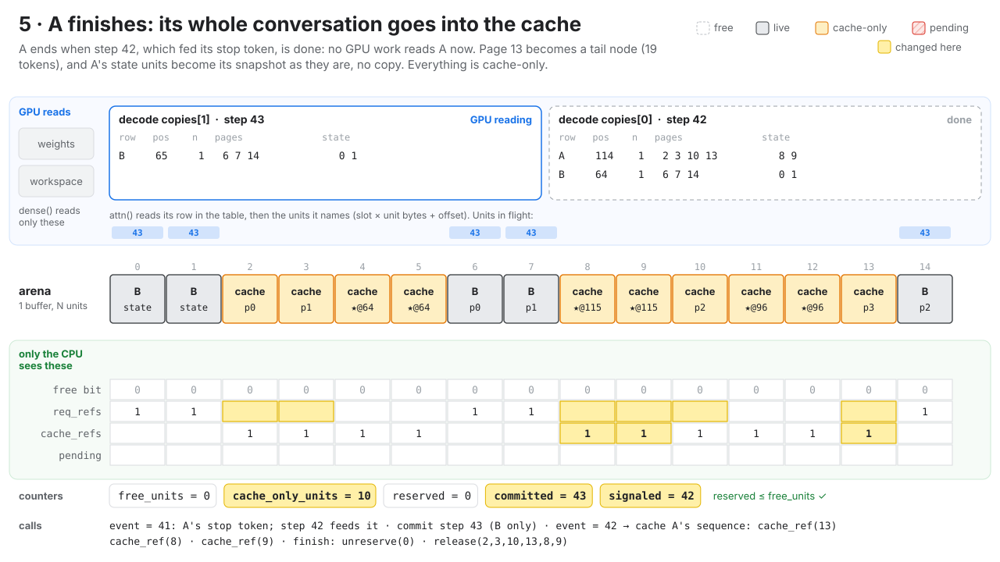

**Notes.** Step 41 gave A its stop token, but step 42 was already committed with A's row: it feeds that token, writing
its K/V and A's state. So A ends at step 42's poll, when no GPU work reads it any more. Then `cache_sequence` inserts
A's whole sequence (prompt + the stop token, 115 tokens): pages 0–2 are cached already, page 13 becomes a tail node
holding 19 tokens, and A's state units 8–9 become the tail's snapshot as they are, with no copy, because A is done with
them. `finish` releases everything A held, and all of it is cache-only. Nothing is pending this time.

---

## 6 · Evict: accounted now, reused later

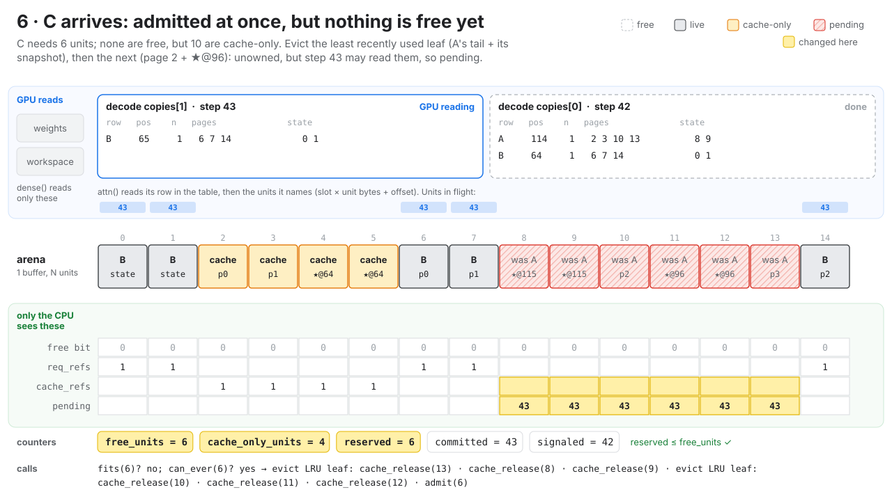

**Notes.** C needs 6 units. None is free, but 10 are cache-only, so `can_ever` says eviction can make room. The least
recently used leaf is A's tail with its snapshot; then page 10 with ★@96. Released by the cache and owned by no one,
they go pending at step 43, the last one committed, even though step 43 only reads B: one number per unit, not a
list of readers. `free_units` counts them at once, so C is admitted now. Their free bits stay 0, so nothing can
write them yet.

---

## 7 · Unit 10 comes back

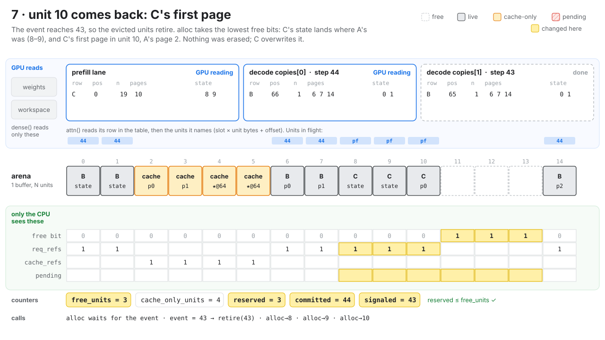

**Notes.** C's first `alloc` finds no free bit, so it waits for the event (at most one step). The event reaches 43,
`retire` frees the six units, and `alloc` takes the lowest free bits: C's state lands in 8–9, where A's state was, and
C's first page in unit 10, A's page 2. Nothing was erased (C's state is zeroed, its page is overwritten by prefill),
and no one can be reading the old bytes, because the GPU is past every step that could name them.

---

## And prefill, on its own lane

- The prefill lane has its own queue: ANE with **2 chunks in flight**, or the GPU; chunks under 256 tokens go to the
  GPU.
- Its K/V lands in the same arena units, through the same step-table format.
- Pending reclaim follows **decode** steps only ⇒ a request can't be released while a prefill chunk still reads it
  (asserted; cancel waits for the chunk).
- A long GPU prefill is cut into chains of 8-layer command buffers so decode steps run in between.

**Notes.** Two producers write into one arena. They never conflict, because a unit belongs to exactly one request
until it's shared, and shared pages are full and read-only. The remaining danger is lifetime: who's still reading a
unit. Decode steps carry the event; prefill chunks are tracked per request (`in_flight`), and finish refuses to
release a request with a chunk out.

---

## Spill to disk (designed, not built yet)

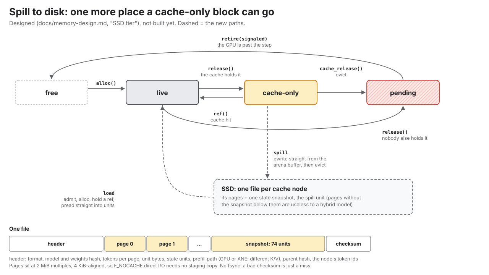

- Only **cache-only** pages spill. A request never references a page that isn't in RAM.
- Spill = `pwrite` the node's pages + its snapshot **straight from the arena buffer**, then evict as usual.
- Load = `admit`, `alloc`, hold a ref, `pread` **straight into the units**, then insert: a cache hit like any other.

**Notes.** Eviction today throws K/V away; the SSD tier would give it a second life. It fits the block's life
without a new state: a spill is an eviction that writes the bytes out first, and a load is an allocation that fills
the units from a file instead of from prefill. It is safe to `pwrite` while the GPU reads the same units, because
cache-only pages are full and never written again. Units sit at 2 MiB multiples, so they are 4 KiB-aligned and direct
I/O (`F_NOCACHE`; macOS has no `O_DIRECT`) can go straight from and to the Metal buffer with no staging copy. One
thing the GPU event doesn't cover: a `pread` is CPU I/O, so the unit needs its own ref until it returns, or a cancel
mid-load would let it go free under the read. The default directory is on the USB T5 (~1 GB/s), still far faster than
re-running a long prefill.

---

## Spill: rules from other engines' bugs

| Rule | Because |
|---|---|
| The spill unit is **a node with its snapshot** | pages without the snapshot below them are useless to a hybrid model |
| Key the file on everything that changes the bytes | model + weights hash, page size, unit bytes, **prefill path** (GPU vs ANE fp16 give different K/V), parent hash, token ids |
| Checksum the whole payload; write a tmp name, then rename | a preallocated file is full-length even when the write never finished |
| Drop the cache's refs only **after** `pwrite` succeeded | on `ENOSPC` / `EIO` the node stays in RAM |
| Every load failure is a miss | missing file, bad checksum, short read, unmounted volume: drop the node, keep refcounts balanced |
| No `fsync` | a spilled page is only a cache |

**Notes.** These come from the bug history of oMLX, vllm-mlx and vllm-metal (`reports/prior art.md`). The rules are in
`docs/memory-design.md` §SSD tier, next to a free-space floor (16 GiB by default) past which eviction drops pages
instead of spilling them.

---

# Part 4: inside one block

One zoom level per slide. The yellow outline is what the next slide opens.

---

## Zoom 1 · the arena: every unit is a page or a piece of a state

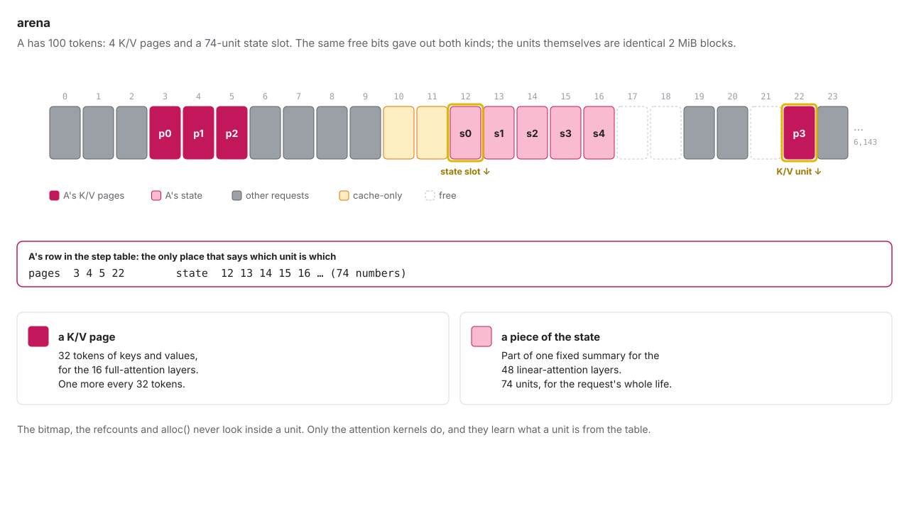

**Notes.** The same window as "Cut it into blocks", now with A's state units marked. To the bitmap, the refcounts and
`alloc`, all units are identical 2 MiB blocks; a request asks for "a unit" and gets the lowest free one, whatever it
will hold. Only A's row in the step table says which of its units are pages and which are its state, and only the
attention kernels read inside them. Zooms 2–4 open page 3 (unit 22); zooms 5–6 open the state.

---

## Zoom 2 · one K/V unit: a row per full-attention layer

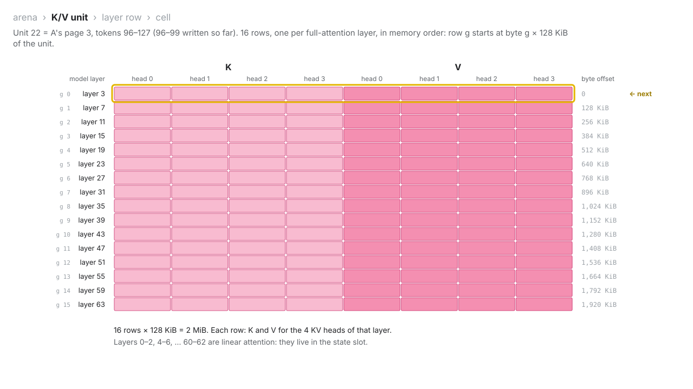

**Notes.** A page holds 32 tokens for **every** full-attention layer, not one layer: 16 rows, in memory order, each
128 KiB. The other 48 layers are linear attention and keep no per-token memory at all, so they have no row here.
That is also why one page is exactly one unit: the unit size was chosen as 16 rows × 128 KiB.

---

## Zoom 3 · one row: layer 3's keys and values

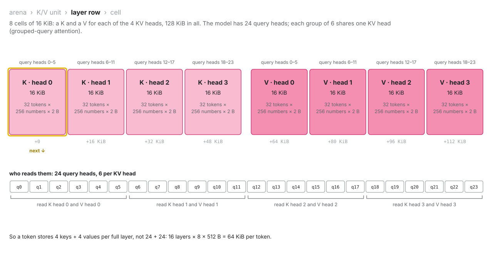

**Notes.** Grouped-query attention: 24 query heads, but only 4 KV heads, so each token stores 4 keys and 4 values per
full layer. That is the difference between 64 KiB per token and 384 KiB. Within the row, cell (K/V, head) starts at
(kv × 4 + head) × 16 KiB.

---

## Zoom 4 · one cell: a line per token

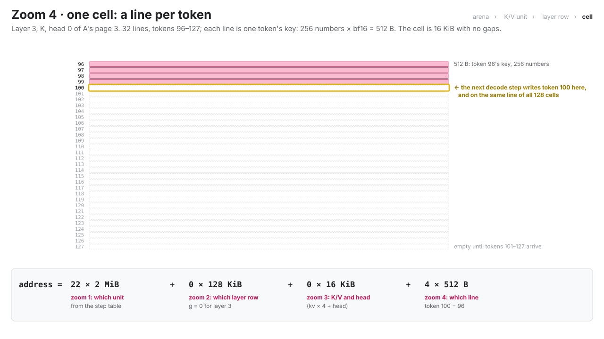

**Notes.** This is where "append only" is literal: each new token writes one 512-byte line, and the next decode step
writes line 100 in each of the unit's 128 cells. Old lines never change, so once all 32 are written the page can be
shared by the cache without a copy. (A part-written page can be cached too, as a tail node; a request continuing it
copies the unit first, because it will write the remaining lines.) Attention for (layer 3, head 0) reads this cell in each of A's pages, in token
order: one contiguous 16 KiB read per page. The address at the bottom is the four zooms added up; no pointer is stored
anywhere.

---

## Zoom 5 · the state slot: 74 units, one byte span

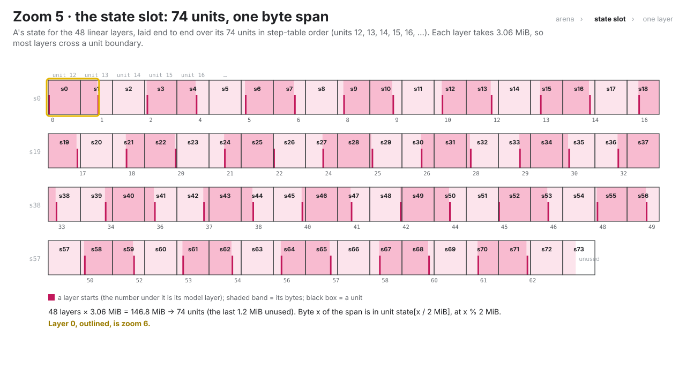

**Notes.** The other use of the same units. A's state for the 48 linear layers is one 146.8 MiB byte span, laid over
its 74 units in the order the step table lists them. A layer takes 3.06 MiB, so layers cross unit boundaries; the
kernel doesn't care, because it finds byte *x* at `state[x / 2 MiB] × 2 MiB + x % 2 MiB`. The units of a slot don't
need to be neighbours either.

---

## Zoom 6 · one linear layer's state: rewritten by every token

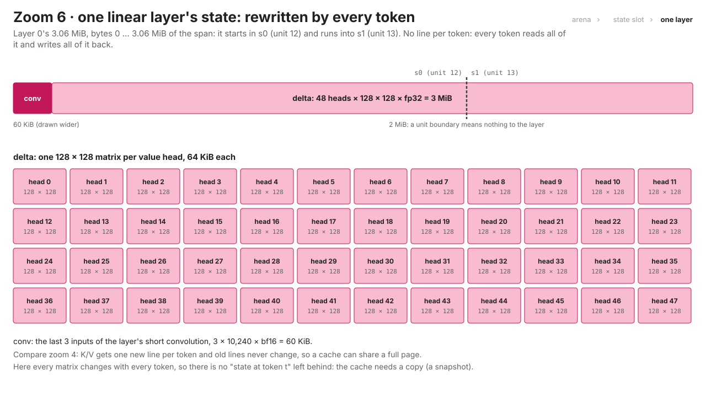

**Notes.** No lines here: every token reads all 48 matrices and writes all of them back. That is why a state can't be
cut at token *t*, why a cache hit needs a snapshot taken exactly where it resumes, and why a running request's
snapshot is a copy while a K/V page is shared as it is. Only a finished request can hand its state over without a
copy: nobody will write it again. Compare zoom 4.

---

# Wrapping up

---

## Does it pay?

| Measured | Without | With |
|---|---|---|
| Same 2k prompt again: time to first token (0.8B) | 435 ms | **19 ms** (17 tokens recomputed) |
| 8 clients, 2k prompts, 1.5k shared: TTFT median (0.8B) | 2.30 s | **0.75 s** |
| Chat, turn 3, first token (27B; v0.2.0 vs v0.3.0's whole-sequence cache) | 3.50 s | **0.49 s** |
| … total throughput (0.8B) | 206 tok/s | **462 tok/s** |
| 27B prefill, 4,096 tokens: GPU vs ANE with one weight copy | 131 tok/s | **191 tok/s** |
| 27B decode while a 2,048-token prefill runs | 3.3 tok/s | **12.1 tok/s** |
| Decode vs mlx-lm (27B, B = 1) | 1.00× | **0.97–0.99×** |

Cache off, batch 1: bit-exact with mlx-lm. Try it: `uvx --from 'mmmllm[compare]' mmmllm compare`.

**Notes.** Prefix-cache rows: `reports/mlx-lm baseline.md` §Prefix cache (g8), cache off vs on, back to back. When
nothing hits, the cache costs nothing measurable. The chat row is from the v0.3.0 commit (`b8af2c9`): before it,
every turn re-prefilled the previous reply (320 of 658 tokens cached at turn 3; after: 639 of 662). The other 27B rows are from `docs/target-27b.md` §5. What the memory
design buys is that serving many requests, sharing prefixes, long contexts and ANE prefill all live in one RAM with
one set of rules.

---

## Takeaways

1. **One RAM, three processors**: no copies between them, but one bandwidth and one set of "who may write" rules.
2. **One copy of the weights**: the ANE takes the GPU's weights as inputs, a layer at a time, instead of its own ~15 GB.
3. **One unit size** for everything: a bit per unit is the whole free list, and nothing fragments.
4. **Slot numbers + a per-step table** instead of pointers: memory never moves, the GPU stays stateless.
5. **Two refcounts** (requests, cache): a page can be a request's and the cache's at once, with no copy.
6. **Reserve, then allocate**: an admitted request can't run out of memory.
7. **Accounting is instant, reuse waits for the GPU**: the pending queue makes async safe.
8. Hybrid models need **state snapshots**: K/V is a log you can cut anywhere, a state is a value you must copy
   (unless its owner is done with it).

---

## Where to look

| Topic | File |
|---|---|
| Design, with the measurements behind each choice | `docs/memory-design.md` |
| The 27B work, ANE with the GPU's weights | `docs/target-27b.md` §5 |
| Who calls whom | `docs/architecture.md` |
| Arena, counters, step tables | `src/memory.h`, `src/memory.mm` |
| ANE blocks, weight surfaces | `src/ane.h`, `src/ane.mm` |
| Prefix cache | `src/prefix_cache.h`, `src/prefix_cache.mm` |
| Admit, snapshot, finish | `src/engine.mm` |

---

# FAQ

---

## Why 32 tokens per page?

| page size | unit (27B) | waste per request (avg) | recompute on a cache hit | slot numbers per 10k tokens |
|---|---|---|---|---|
| 16 | 1 MiB | 0.5 MiB | ≤ 15 tokens | 625 |
| **32** | **2 MiB** | **1 MiB** | **≤ 31 tokens** | **313** |
| 64 | 4 MiB | 2 MiB | ≤ 63 tokens | 157 |
| 128 | 8 MiB | 4 MiB | ≤ 127 tokens | 79 |

- Bandwidth doesn't care: reading shuffled units runs at 243–249 GB/s for 16 to 128, same as one contiguous stream.
- Smaller pages waste less and recompute less; larger pages mean shorter slot lists and fewer prefix-cache nodes.

**Notes.** `page_tokens = 32` is a constructor parameter of `Memory` and `Engine`, not a command-line flag. The
recompute column is for a new prompt that shares only full pages with the cache (a system prompt); a sequence that continues a cached tail node (a chat turn) recomputes nothing. The state slot follows the unit size: 147 MiB is
74 units at 2 MiB, 147 at 1 MiB. Not to be confused with the prefill *chunk* (512 tokens on the GPU, 1,024 on the
ANE), which is a multiple of the page size so every chunk starts on a page.

---

## Why one unit size for everything?

Engines often keep separate pools per kind of state (K/V pages, recurrent state, sliding-window pages) and tune their
ratio. Here there is one size, so any free unit serves any need: a request that needs a state slot takes 74 of
whatever units are free, scattered or not. No bands, no ratio setting, nothing to compact, and the free list is one
bit per unit. The cost is that a state slot is rounded up to whole units (147 MiB → 74 × 2 MiB, under 1% waste).

---

## Who touches which region, in prefill and in decode?

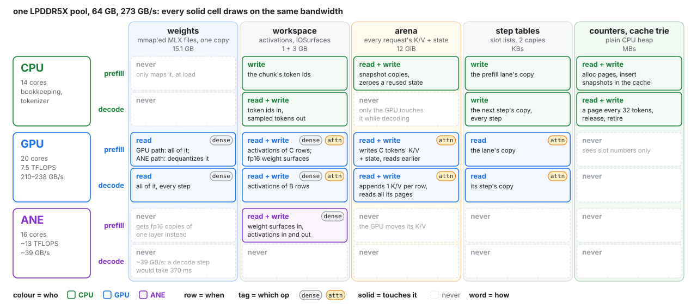

**Notes.** The split slide's columns, with each processor's row cut into prefill and decode. A cell's colour says
who, its word says how, its tag says which op does it (`dense` or `attn`), and a dashed cell means never. The ANE's
only region is the workspace: weight surfaces in, activations in and out. It never touches the arena; the GPU moves
its K/V there.

---

## What does the model do, as far as memory cares?

```python
# PREFILL: one call per chunk of one prompt
x = embed(A's prompt tokens)              # C rows
for i in layers:                          # 64 layers, in order
    x = dense_i(x)                        #   all C rows at once, weights W_i read once
    x = attn_i(x, A's memory)             #   writes C tokens' K/V, overwrites A's state

# DECODE: one step per new token
while requests are running:
    x = embed([A: "?", B: " a", C: " ="]) # 1 row per request
    for i in layers:
        x = dense_i(x)                    #   all B rows at once, weights W_i read once
        x = attn_i(x, memories)           #   each row: append 1 to its own memory, read all of it
    next = sample(lm_head(x))             # 1 token per row, fed back in on the GPU
```

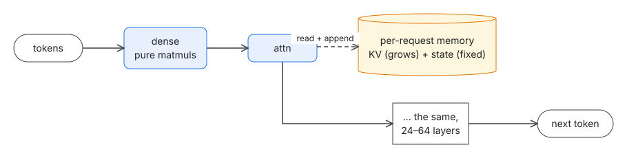

**Notes.** `dense` works on rows of activations and never touches the arena; every row multiplies the same weights,
so a batch pays the weight bytes once. Attention is the opposite: each row's operand is its own request's memory. In
decode a row writes one token's K/V and then reads the whole context so far; batching doesn't share any of that.

---

## Fewer, bigger matmuls?

1. **Same input, different weights → concatenate the weights.** q/k/v (and gate/up) multiply the same `x`: one matmul.
2. **Same weights, different inputs → stack the rows.** That is batching: a prefill chunk, a decode step.
3. **Different inputs and operands (attention, per request) → no merge**, only a grouped kernel.

- mmmllm merges (1) **only in decode** (M = 1), and gets (2) everywhere.
- The ANE wants the opposite of (1): weights **split** into small pieces.

**Notes.** At M = 1 each projection is a thin matrix-vector product; three small ones underfill the GPU and pay a
launch each, one wide one streams the same bytes in one pass. The weights keep each group's parts back to back, so the
merged weight is just a longer buffer. In prefill each projection already saturates compute, so merging gains nothing.

---

## Does a residency set keep the weights in RAM?

No. Under memory pressure macOS evicted idle buffers in a residency set anyway, file-backed and anonymous (measured,
`tools/residency_check.swift`). Metal pages them back in before the next command buffer runs, which stalls it (4 GiB:
~5 s from the USB volume). Weights read every decode step stay hot; the defence is not to overcommit RAM. Whether
`mlock` holds is still to be measured on an idle machine (`docs/target-27b.md`).
